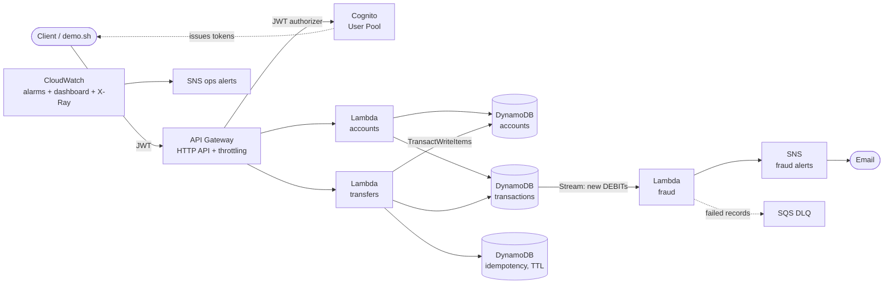

# Ledgerly: serverless banking ledger API on AWS

A small but production-minded banking backend. Users sign in, open accounts, fund them,
and send money to each other. Every transfer is **atomic**, **idempotent** and recorded as
**double-entry** ledger rows. Every debit is checked for fraud asynchronously.

Everything is deployed with **Terraform** through a **GitHub Actions** pipeline that
authenticates to AWS with **OIDC**, so no access keys are stored anywhere.

## Architecture



| Area | Services |
|---|---|
| API and auth | API Gateway HTTP API, Cognito JWT authorizer, rate limiting |
| Compute | 3 Lambda functions (Python 3.12, arm64), one IAM role each |
| Data | DynamoDB (on-demand, encrypted, point-in-time recovery, TTL, Streams) |
| Events | DynamoDB Streams, event filtering, SNS, SQS dead-letter queue |
| Observability | CloudWatch logs, alarms, dashboard, Embedded Metric Format, X-Ray |
| Delivery | Terraform, S3 remote state with locking, GitHub Actions, OIDC |

## Screenshots

**CI/CD pipeline: lint, 37 tests and Terraform checks, then deploy to AWS via OIDC**


**Live demo against the deployed API: retry not double-charged, theft blocked (404), overdraft blocked**


**Fraud alert email, triggered asynchronously from the DynamoDB Stream**


**CloudWatch dashboard: API traffic, latency, Lambda errors and fraud flags**


## Design decisions (the interview talking points)

**Money is an integer in minor units.** `amount: 1050` means 10.50. Floats can't represent
money exactly (`0.1 + 0.2 != 0.3`), so they are rejected by validation.

**Double-entry ledger.** A transfer writes two immutable rows: a DEBIT on the sender and a
CREDIT on the receiver. Total money in the system only changes via deposits; the test
`test_money_is_conserved_across_many_transfers` checks this.

**Atomic transfers with one DynamoDB transaction.** Debit, credit, both ledger rows and the
idempotency record are written in a single `TransactWriteItems`. Either all five happen or
none do. Overdrafts are prevented with a condition (`balance >= :amt`), not a read-then-write,
so two simultaneous transfers can't both spend the same money.

**Idempotency keys.** Clients send an `Idempotency-Key` header. If a mobile app retries after a
timeout, the stored response is returned instead of charging twice. Reusing a key with a
different body returns `422`. Keys are scoped per user and expire after 24 hours via TTL.

**Fraud checks read the DynamoDB Stream.** The transfer Lambda doesn't publish an event itself,
because "save to DB, then publish" can fail halfway (the dual-write problem). The stream
only contains committed writes. An event filter means the fraud Lambda only runs for DEBITs.
Failed records are retried, the batch is split to isolate bad records, and anything still
failing goes to an SQS dead-letter queue with an alarm on it.

**Security.** Every route needs a Cognito token. Each Lambda has its own least-privilege IAM role.
Other users' accounts return `404`, not `403`, so attackers can't discover which account IDs
exist. Pagination tokens are bound to the account, so a tampered token can't read someone
else's history. The API is rate-limited. Tables are encrypted with point-in-time recovery.

**No stored AWS keys.** GitHub Actions gets short-lived credentials through OIDC. The AWS role
trusts only this repository's `dev` and `prod` GitHub environments.

## API

All requests need `Authorization: Bearer <Cognito access token>`.

| Method | Path | Description |
|---|---|---|
| POST | `/accounts` | Open an account `{"currency": "GBP"}` (GBP, EUR, USD) |
| GET | `/accounts` | List my accounts |
| GET | `/accounts/{id}` | Balance and details |
| POST | `/accounts/{id}/deposits` | Simulated funding `{"amount": 50000}` (max 10,000.00) |
| GET | `/accounts/{id}/transactions` | History, newest first, `?limit=&next_token=` |
| POST | `/transfers` | Send money (needs `Idempotency-Key` header) |

Example transfer body:

```json
{"from_account_id": "...", "to_account_id": "...", "amount": 12500, "currency": "GBP", "reference": "Dinner"}
```

Errors always look like `{"error": {"code": "insufficient_funds", "message": "..."}}`.

---

## Step-by-step setup

### What you need

| Thing | Notes |
|---|---|
| AWS account | Free tier is enough |
| AWS CLI v2 | Logged in with an admin user or SSO profile (`aws sts get-caller-identity` works) |
| Terraform 1.10 or newer | `terraform -version` |
| Python 3.12 | For running tests locally |
| Git and a GitHub account | |
| `jq` and `curl` | For the demo script |

### 1. Run the tests locally

```bash
python3.12 -m venv .venv && source .venv/bin/activate
make install
make test        # 37 tests, all AWS calls mocked with moto, no AWS account needed
```

### 2. Protect your wallet first

In the AWS console go to **Billing → Budgets → Create budget**, choose a monthly cost budget
of £5 with email alerts. Do this before deploying anything.

### 3. Create the GitHub repo and push

```bash
git init && git add . && git commit -m "Initial commit"
git branch -M main
git remote add origin https://github.com/<you>/ledgerly.git
git push -u origin main
```

The Deploy workflow will run and fail at "Authenticate to AWS". That's expected until step 5.

### 4. Bootstrap AWS (one time, from your laptop)

This creates the Terraform state bucket and the role GitHub Actions will use.

```bash
cd infra/bootstrap
terraform init
terraform apply -var="github_owner=<your-github-username>"
```

Note the two outputs: `deploy_role_arn` and `state_bucket`.

If you get "EntityAlreadyExists" for the OIDC provider, your account already has one for GitHub.
Delete the `aws_iam_openid_connect_provider` resource and point the role at the existing
provider's ARN instead.

### 5. Configure GitHub

In your repo: **Settings → Environments**:
1. Create an environment named `dev`.
2. Create an environment named `prod` and add yourself under **Required reviewers**
   (this is your manual approval gate for production).

Then **Settings → Secrets and variables → Actions → Variables** and add repository variables:

| Variable | Value |
|---|---|
| `AWS_DEPLOY_ROLE_ARN` | `deploy_role_arn` from step 4 |
| `TF_STATE_BUCKET` | `state_bucket` from step 4 |
| `ALERT_EMAIL` | Your email, for fraud and ops alerts |

### 6. Deploy

Go to **Actions → Deploy → Re-run jobs** (or push any commit to `main`). It runs lint, tests and
Terraform checks, then deploys to `dev`. The run summary shows your API URL.

You'll get two emails from AWS SNS asking you to confirm subscriptions. Click both links.

To deploy prod: **Actions → Deploy → Run workflow → prod**, then approve it.

### 7. Run the demo

The demo reads Terraform outputs, so connect your laptop to the same state:

```bash
cd infra
terraform init \
  -backend-config="bucket=<state_bucket>" \
  -backend-config="key=ledgerly/dev.tfstate" \
  -backend-config="region=eu-west-2" \
  -backend-config="use_lockfile=true"
cd ..
./scripts/demo.sh
```

It creates two users, opens accounts, deposits, transfers, retries with the same key,
tries to steal and overspend (both rejected), and sends a large transfer that triggers a
fraud alert email. Open the CloudWatch dashboard link it prints at the end.

**Take screenshots** of the demo output, the dashboard, the fraud email and a green pipeline run,
and add them to this README. Recruiters look at pictures before code.

### 8. Tear down when you're done

```bash
cd infra && terraform destroy
```

(Prod has deletion protection on tables and the user pool. Turn it off in the console first
if you really want to delete prod.)

## Cost

Everything is serverless and pay-per-request, so with demo traffic this costs close to
nothing, usually well under £1 a month and mostly within the free tier. Nothing runs
(and nothing charges you) while nobody is calling the API.

## Project structure

```
src/app/            Lambda code (accounts, transfers, fraud, shared helpers)
tests/              pytest + moto tests
infra/              Terraform for the application
infra/bootstrap/    One-time Terraform: state bucket + GitHub OIDC role
scripts/demo.sh     End-to-end demo against a deployed environment
.github/workflows/  CI (lint, tests, terraform validate) and Deploy (OIDC + terraform apply)
```

## What I'd improve next

- Replace `AdministratorAccess` on the deploy role with a scoped policy and a permissions boundary
- Customer-managed KMS key with rotation for tables and topics
- Store `balance_after` on each ledger row and a nightly reconciliation job (sum of entries == balance)
- Add AWS WAF in front of the API (needs a REST API or CloudFront)
- Contract tests against the deployed API in the pipeline after deploy
- Security scanning in CI (Checkov or tfsec) and Dependabot
- A small React frontend on S3 + CloudFront

## Questions I can answer about this project

Use these to check your understanding before an interview:

1. Why integers instead of floats for money?
2. What would go wrong if the transfer read the balance, checked it in Python, then wrote it?
3. What exactly does the idempotency key protect against? What if two retries arrive at the same time?
4. Why read the DynamoDB Stream instead of publishing to SNS from the transfer Lambda?
5. What happens when the fraud Lambda fails? Walk through retries, bisecting and the DLQ.
6. Why does someone else's account return 404 instead of 403?
7. How does GitHub Actions get into AWS without keys? What stops another repo using the role?
8. Why separate IAM roles per Lambda?
9. Why DynamoDB here rather than RDS? When would you choose RDS for a bank?
10. Why is the ops SNS topic not encrypted when the fraud one is?
